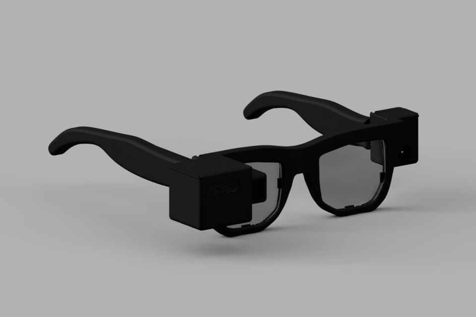
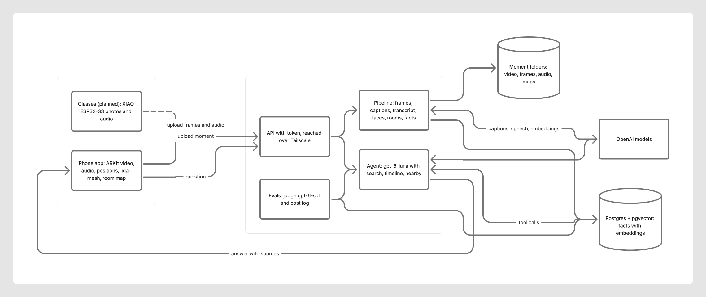
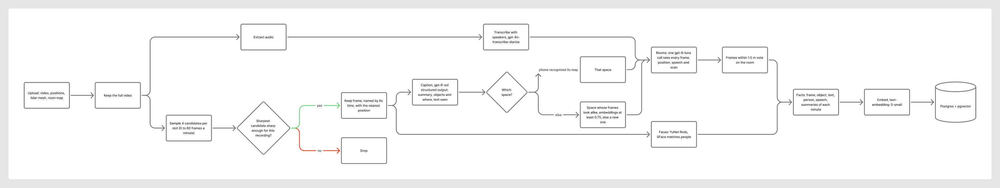
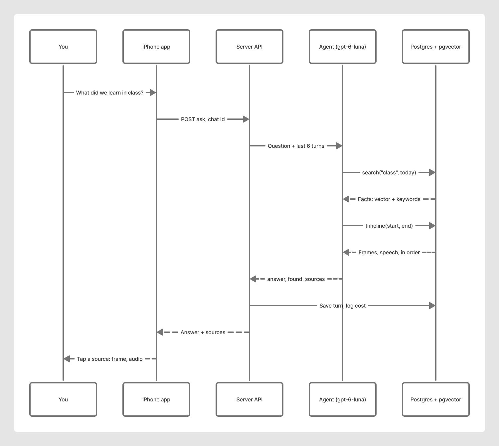
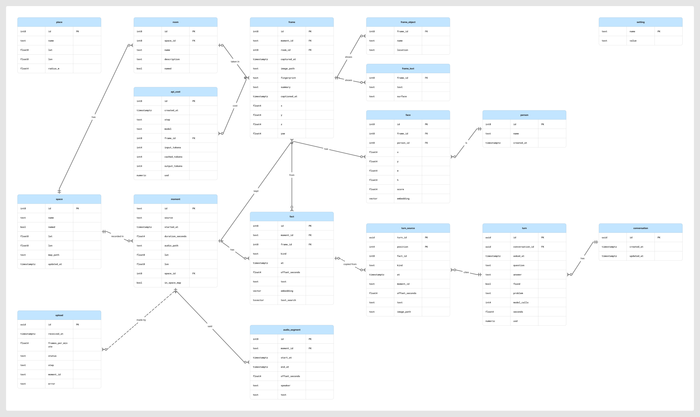

# Memory Glasses

Camera glasses that record what you see and hear, and an agent that answers any question about it: what a sign
said, who you talked to, what you were doing, where something was. Ask "what did the whiteboard say in
Tuesday's lecture?" or "who was at lunch?" and get an answer with the photos and speech it came from, or an
honest "I don't know".



## Purpose and goals

- **Answer any question about what you saw or heard**, with sources you can tap to check.
- **Say "I don't know"** when the memory doesn't hold the answer, instead of making one up.
- **Measure it**: evals show how often answers are right, whether the right fact was found, and what each answer
  costs.
- **Stay small enough to explain** in a class report.

The graded part is the LLM software: embeddings, structured output, tool calling and a judge model. An iPhone
app records and asks questions today. The glasses (an ESP32-S3 with a camera and a small display) send photos
over the phone's hotspot. Audio from the glasses comes next.

## System design



1. The **glasses** or the **iPhone app** record a **moment**: photos (frames), audio and, on the phone, where it was
   in the room.
2. The **FastAPI server** (Python) runs the pipeline:
   - it keeps the frames that differ from each other;
   - an OpenAI model captions each one (a summary, objects and where they are, text it can read);
   - the audio becomes a timed transcript;
   - faces are matched to people, and rooms are worked out.
3. Everything becomes small **facts**, each embedded with its context, in **Postgres with pgvector**.
4. The **agent** answers a question using three tools:
   - **search** finds facts by meaning and by exact words;
   - **timeline** lists what happened around a time;
   - **nearby** finds what was seen near a spot in the same room.
5. A **judge model** grades answers to a set of test questions. Every model call logs its tokens and cost.

How one moment is processed:



How a question is answered:



## Data model (ERD)



- A **moment** has many **frames** and **audio segments**.
- Frames have **objects**, **text seen** and **faces**; each face belongs to a **person**.
- **Facts** come from frames or speech and carry the embeddings that search uses.
- A **space** (an apartment, a lecture hall) holds **rooms**. Frames are placed in a room, and spaces can sit at
  a named **place**.
- **Conversations** have **turns** (a question and its answer), and each turn cites the facts it used.
- **api_cost** logs every model call; **upload** tracks a recording while it processes.

## UX sketch

The iPhone app (SwiftUI) has four tabs:

```
┌──────────────┐  ┌──────────────┐  ┌──────────────┐  ┌──────────────┐
│ Ask          │  │ Timeline     │  │ Stats        │  │ Glasses      │
│              │  │ ● Record     │  │              │  │ Recording ◉  │
│ "Who was at  │  │ Today        │  │ Right   ▓▓▓░ │  │ Sending, 12  │
│  lunch?"     │  │  ▢ Kitchen   │  │ Found   ▓▓▓▓ │  │ pictures     │
│              │  │  ▢ Lecture   │  │ Cost a reply │  │ Camera rate  │
│ Sam and Alex │  │ Yesterday    │  │ Cost by step │  │ Display      │
│ [photo][said]│  │  ▢ Walk home │  │              │  │ People       │
│ follow-up…   │  │              │  │              │  │ Places       │
└──────────────┘  └──────────────┘  └──────────────┘  └──────────────┘
```

Tapping a source opens its frame: the photo, nearby frames, what was said then, and the audio. A moment shows its
video, its path through the room from above, and the lidar room in 3D.

## Daily goals through the end of class

Parts 1–9 work: recording to moment, database, captions, speech, facts and search, agent, evals, API and the
iPhone app. The glasses already send photos. What's left:

| Day | Goal |
| --- | --- |
| Wed Nov 18 | Post this overview; set the display focus with the spacers and update the CAD |
| Thu Nov 19 | Glasses audio: record from the board's microphone |
| Fri Nov 20 | Send audio with the photos; the server joins them into one moment |
| Sat Nov 21 | Wear the glasses for a day of real moments; fix what breaks |
| Mon Nov 23 | Add eval questions from those moments: signs, people, conversations, places |
| Tue Nov 24 | Run the evals in every mode; compare agent and plain and record the costs |
| Wed Nov 25 | Improve the weakest kind of question found by the evals |
| Thu–Sat Nov 26–28 | Thanksgiving break: light work only, try the battery again |
| Mon Nov 30 | Show answers on the glasses' display |
| Tue Dec 1 | Re-run the evals; tag the release |
| Wed Dec 2 | Write the report: system design, ERD, eval results and costs |
| Thu Dec 3 | Finish the report; record a demo video |
| Fri Dec 4 | Rehearse the presentation |
| Mon Dec 7 – end of class | Present; final fixes from feedback |

## Code

- `server/`: Python with `uv`: pipeline, agent, evals and API.
- `app/`: the SwiftUI iPhone app.
- `firmware/`: Rust for the XIAO ESP32-S3 Sense.
- `hardware/`: CAD, print files, parts and wiring.
